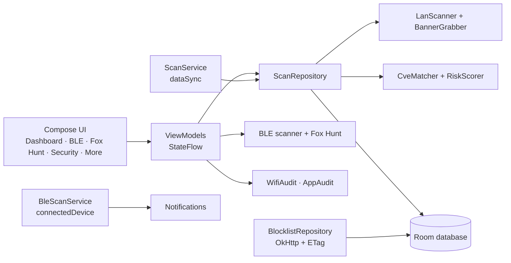

<div align="center">

# 📡 PocketLab

### Your pocket-sized radar for Wi-Fi, Bluetooth trackers and risky apps

*A small contribution to the open-source community — free forever, no paid servers, no telemetry.*


**Made by [Aditya Bhosale](https://github.com/Adiseclabs)** · +91 9324218321 · adityabhosale212223@gmail.com

</div>

---

## ✨ What is PocketLab?

PocketLab turns your phone into a small security lab. In a few taps it can tell you:

- 🏠 **Who is on your Wi-Fi** and which of those devices look risky
- 🏷️ **Whether a Bluetooth tracker is following you** — and then help you *find it*
- 🔐 **How secure your Wi-Fi really is**
- 📲 **Which installed apps look suspicious** (sideloaded, hidden, over-permissioned)

Everything runs **on your device**. No account, no ads, no analytics, no paid servers. The only internet traffic is the download of public blocklists.

> **What PocketLab will never do:** no VPN, no firewall, no traffic blocking, no packet capture, no root.

---

## 🧭 Feature tour

| | Feature | In one line |
|---|---|---|
| 🌐 | **LAN Scanner** | Finds devices on your Wi-Fi, reads banners, scores risk |
| 🔔 | **New-device alerts** | Notifies you when an unknown device joins |
| 🏷️ | **BLE Tracker Detection** | Spots AirTag, SmartTag, Tile, Chipolo, Pebblebee |
| 🦊 | **Fox Hunt** | Radar + vibration guide you to a hidden tracker |
| 📍 | **Nearby-device alert** | Pings you when a new Bluetooth device is very close |
| 🛡️ | **Offline CVE hints** | Matches service versions to known vulnerabilities |
| 📶 | **Wi-Fi Security Check** | Rates your Wi-Fi from 0 to 100 |
| 📲 | **App Risk Review** | Flags sideloaded, hidden and over-permissioned apps |
| 🚫 | **Advisory blocklists** | Flags bad hostnames — never blocks anything |
| 📤 | **CSV export** | Save LAN, BLE and Fox Hunt results |

### 🌐 LAN Scanner
Sweeps your Wi-Fi subnet (/24) with up to 50 parallel probes — ping first, then a TCP fallback on ports 80, 443, 22 and 8080. Live hosts are checked for risky ports (21, 23, 445, 3389, 6379, 27017), service banners (HTTP `Server`, SSH, FTP greeting) and hostnames.

- Dashboard with **summary stats**, risk badges, pull-to-refresh and a progress bar
- **Tap any IP** for a detail card: ports, banner, vendor, first/last seen, *Open in browser*, *Copy IP*

### 🔔 New-device alerts
Switch on the background monitor and PocketLab re-scans every 5 minutes (15 in battery saver). A device it has never seen triggers a high-priority notification with vibration: **`New device: <IP> <hostname>`**. The first scan only builds a baseline, so you are not flooded.

### 🏷️ BLE Tracker Detection
A low-power background service listens for **5 seconds every 15 minutes** and recognises the advertisement patterns of Apple Find My (AirTag), Samsung SmartTag, Tile, Chipolo and Pebblebee.

| What it sees | What happens |
|---|---|
| A known tracker, briefly | Silent log only |
| Same tracker near you ~15 min, **or** at 3+ different places | 🚨 **CRITICAL** alert: long vibration, sound, full-screen notification |

### 🦊 Fox Hunt — find the hidden tracker
Tap **Hunt** on a device and a short how-to popup tells you what to do. Then follow your senses:

```
        far                                   close
   ○ small circle   ───────────────▶   ● big circle
   ▁ empty bar                          █ full bar
   · short buzz                         ▮ long buzz
```

- Fast, filtered scan of **just that device**
- Circle and bar grow with signal strength; vibration pulses stretch from **50 ms** (far) to **250 ms** (close)
- Stops by itself after **10 minutes**, or when the signal is stronger than **−45 dBm** (*Found it!*)
- Never runs together with a LAN scan — better readings, better battery
- After stopping, **export the signal history** as CSV

### 📍 Nearby-device alert
A never-seen Bluetooth device within roughly **1–3 m** (RSSI ≥ −55 dBm) sends a notification. At most one per 10 minutes, the first scan is only a baseline, and you can turn it off in Settings.

### 🛡️ Offline CVE hints & risk score
A bundled `cve-db.json` (3 examples — extend it!) is loaded into the local database on first launch. Banner service + version are matched against it and shown as expandable cards with CVSS, description, reference link and a fix hint. Every device gets a **0–100 risk score** (Critical / High / Medium / Low / Clean) and the Security tab shows a network score plus the top 5 vulnerable devices.

### 📶 Wi-Fi Security Check
Rates the Wi-Fi you are connected to, with a severity and a fix for each finding:

- Encryption: open, WEP, WPA/WPA2, WPA3
- Wi-Fi standard and band
- Router exposure: Telnet, FTP, plain-HTTP admin page
- Router software matching known CVEs (banner-based)
- Unencrypted DNS (Private DNS off)
- Risky devices found by your LAN scan

### 📲 App Risk Review
Reviews your installed apps (not system apps) and rates each one:

- 📦 **Sideloaded** — not from a trusted store
- 👻 **Hidden** — no launcher icon
- 🎒 **Over-permissioned** — many sensitive permissions
- ⚠️ Powerful permissions (SMS, overlay, install packages, accessibility, background location), debuggable builds, very old target versions

Filter by flag, tap an app for details, jump straight to its system settings.

### 🚫 Advisory blocklists
Downloads **StevenBlack, Phishing Army, URLhaus and OpenPhish** (ETag-cached, ~10 MB once). Used *only* to flag hostnames seen on your LAN. Nothing is blocked or intercepted.

### 📤 Export
Once a scan is stopped, export **LAN devices**, **BLE devices** and **Fox Hunt signal history** as CSV through the system file picker (no storage permission). Device-supplied text is sanitised against spreadsheet formula injection.

### 🎨 And the details
Radar app icon, dark theme, animated radar splash, 3-step onboarding, an **About Me** screen with the full project description, and Settings for retention (1–30 days), start-on-boot, battery saver, nearby alert, blocklist refresh and data reset.

---

## 🔋 Battery philosophy

| Mode | Behaviour |
|---|---|
| **Default** | BLE background watch only — short, low-power scans |
| **LAN scan** | On demand, or every few minutes if you enable the monitor |
| **Fox Hunt** | Short-lived by design |

> Power use has not been measured yet — treat any battery figure as a design goal, not a result.

---

## 🧩 How it fits together



**Tech stack:** Kotlin · Jetpack Compose (Material 3) · MVVM · Hilt · Room · Coroutines & Flow · OkHttp · minSdk 26 · targetSdk 34

---

## 🔐 Permissions — and why

| Permission | Why |
|---|---|
| `INTERNET` | Download blocklists only |
| `ACCESS_NETWORK_STATE`, `ACCESS_WIFI_STATE`, `NEARBY_WIFI_DEVICES` | Find your subnet, read Wi-Fi security (never for location) |
| `BLUETOOTH_SCAN` (*neverForLocation*), `BLUETOOTH_CONNECT` | Tracker detection |
| `POST_NOTIFICATIONS`, `VIBRATE`, `USE_FULL_SCREEN_INTENT` | Alerts |
| `FOREGROUND_SERVICE` (+ data sync / connected device) | Background monitor and tracker watch |
| `RECEIVE_BOOT_COMPLETED` | Optional start on boot |
| `QUERY_ALL_PACKAGES` | App Risk Review needs to list installed apps |

No `BIND_VPN_SERVICE`. No `VpnService`.

---

## ⚠️ Honest limitations

- Android 10+ hides other devices' MAC addresses, so vendor names are often *Unknown*.
- BLE sees only devices that are **actively advertising**; Bluetooth Classic and non-discoverable devices are invisible.
- Trackers rotate their Bluetooth address, so long-term detection is best effort. The "3 places" rule uses the Wi-Fi gateway as a rough stand-in for location.
- The nearby alert only sees devices during the short background scan window.
- Banner versions ignore distro backports — CVE matches are **hints, not proof**.
- The Wi-Fi network name is hidden without location permission; encryption type needs Android 12+.
- "Hidden" and "sideloaded" app flags can have legitimate reasons.
- A tracker alert is a warning to investigate, not proof of stalking.

---

## 🛠️ Build it

```bash
./gradlew assembleDebug
# APK → app/build/outputs/apk/debug/
```

Or let GitHub do it: every push runs `.github/workflows/build-apk.yml` and uploads the **PocketLab-debug-apk** artifact (Actions → latest run → Artifacts).

## 🗺️ Ideas for next steps

- A bigger offline CVE database and the full IEEE OUI list
- Unit tests for the scoring and signature code
- Screenshots in `docs/screenshots/`
- Translations

*(Ideas, not promises — contributions welcome.)*

## 🤝 Contributing

Issues and pull requests are welcome. Keep to the project rules: **on-device only, FOSS-only dependencies, no VPN/firewall/capture features.**

## 👤 Author

**Aditya Bhosale** — building small, honest security tools.
📞 +91 9324218321 · ✉️ adityabhosale212223@gmail.com · 🐙 [github.com/Adiseclabs/PocketScan](https://github.com/Adiseclabs/PocketScan)

## 📄 License

Apache-2.0 — see [`LICENSE`](LICENSE) and [`NOTICE`](NOTICE).
